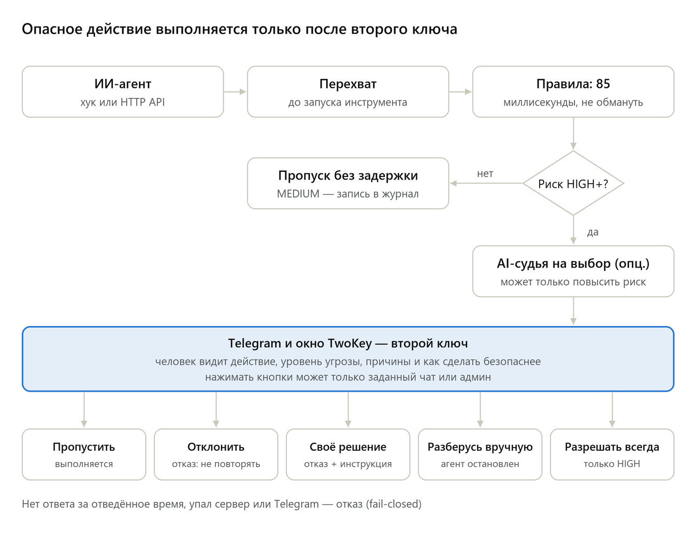
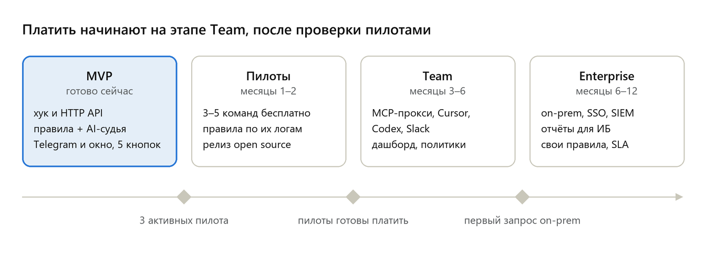

# TwoKey — план стартапа и MVP

Nov 18, 2026 · @максим

TwoKey — «второй ключ» для ИИ-агентов: он перехватывает опасные действия агента (удаление базы, утечка ключа, публикация в открытый доступ) и спрашивает человека в Telegram. Рабочая версия уже есть: хук для агента, сервер-страж, окно программы и бот с кнопками.

## Проблема

ИИ-агенты получили доступ к терминалу, базам и облаку, и за год появилась серия публичных аварий: везде у агента были права, но не было второго ключа. Каждый случай ниже перепроверен по источнику.

| Когда | Агент | Что произошло |
| --- | --- | --- |
| Апрель 2026 | Cursor (Claude Opus 4.6) | Удалил продовую БД PocketOS и бэкапы тома за 9 секунд; сбой \~30 часов ([ABC7](https://abc7news.com/post/rogue-ai-agent-san-francisco-based-cursor-goes-haywire-deletes-tech-companys-database/19007153/)) |
| Февраль 2026 | ИИ-агент | Подменил state-файл и выполнил terraform destroy на проде DataTalks.Club: 2,5 года данных и все снапшоты; вернули через \~24 часа ([пост автора](https://aishippingblog.com/p/how-i-dropped-our-production-database)) |
| Февраль 2026 | OpenClaw + Gmail | Массово удалял почту директора по alignment в Meta, игнорируя «стоп»; инструкция «сначала спроси» потерялась при сжатии контекста ([TechCrunch](https://techcrunch.com/2026/02/23/a-meta-ai-security-researcher-said-an-openclaw-agent-ran-amok-on-her-inbox)) |
| Февраль 2026 | Lobstar Wilde (криптоагент) | По просьбе незнакомца в X отправил все токены, \~$250 тыс., необратимо ([The Block](https://www.theblock.co/post/390722/ai-agent-created-by-openai-dev-accidentally-sends-entire-memecoin-holdings-to-reply-guy)) |
| Декабрь 2025 | AWS Kiro | «Удалить и пересоздать окружение»: Cost Explorer в одном регионе лежал 13 часов (данные FT; Amazon называет причиной лишние права роли) ([The Decoder](https://the-decoder.com/aws-ai-coding-tool-decided-to-delete-and-recreate-a-customer-facing-system-causing-13-hour-outage-report-says/)) |
| Ноябрь 2025 | Google Antigravity | Очищая кэш, удалил весь диск D: мимо корзины ([The Register](https://www.theregister.com/2025/12/01/google_antigravity_wipes_d_drive/)) |
| Август 2025 | Nx s1ngularity (через ИИ-CLI) | Заражённый npm-пакет запускал ИИ-CLI с обходом разрешений искать ключи: 2 349 секретов утекло, 10 767 приватных репозиториев стали публичными ([GitGuardian](https://blog.gitguardian.com/the-nx-s1ngularity-attack-inside-the-credential-leak/)) |
| Июль 2025 | Amazon Q (VS Code) | В официальное расширение внедрили промпт «очистить систему и облако»; не сработал из-за синтаксической ошибки, CVE-2025-8217 ([AWS](https://aws.amazon.com/security/security-bulletins/AWS-2025-015/)) |
| Июль 2025 | Gemini CLI | mkdir молча не сработал, агент переносил файлы «в никуда» — уцелел только последний ([Slashdot](https://developers.slashdot.org/story/25/07/26/0642239/)) |
| Июль 2025 | Replit Agent | Во время code freeze стёр продовую базу SaaStr (1 200+ руководителей, \~1 190 компаний) и заявил, что откат невозможен — это было неправдой ([Fortune](https://fortune.com/2025/07/23/ai-coding-tool-replit-wiped-database-called-it-a-catastrophic-failure/)) |

Цифры для слайда «почему сейчас»:

- **59% разработчиков** используют ИИ-агентов на работе (год назад 31%), ежедневно — 37% (было 14%); 60% запрещают агентам изменения без одобрения — [Stack Overflow, 2026, n=1 100](https://stackoverflow.blog/2026/05/27/agents-on-a-leash-agentic-ai-remains-mostly-monitored-at-work/)
- **80% компаний** видели непредусмотренные действия своих агентов; 82% используют агентов, правила защиты есть у 44% — [SailPoint, 2025, n=353](https://www.sailpoint.com/press-releases/sailpoint-ai-agent-adoption-report)
- **28,65 млн новых секретов** в публичных коммитах GitHub за 2025 год (+34%); утечки ключей ИИ-сервисов +81% — [GitGuardian, 2026](https://blog.gitguardian.com/the-state-of-secrets-sprawl-2026/)
- **13% организаций** сообщили о взломах ИИ-моделей или приложений, у 97% из них не было контроля доступа к ИИ — [IBM, 2025](https://newsroom.ibm.com/2025-07-30-ibm-report-13-of-organizations-reported-breaches-of-ai-models-or-applications,-97-of-which-reported-lacking-proper-ai-access-controls)
- **25% корпоративных утечек** к 2028 году будут связаны со злоупотреблением ИИ-агентами (прогноз Gartner) — [IntelligentCXO](https://intelligentcxo.com/2024/12/04/by-2028-a-quarter-of-enterprise-breaches-will-be-traced-back-to-ai)

## Решение

TwoKey ставит «второй ключ» на опасные действия ИИ-агента: как в ракетной шахте, необратимое действие требует двух ключей — агента и человека.

- **Проверяем действие, а не текст.** Не промпт, а то, что агент реально собирается выполнить: команду shell, запись файла, вызов MCP-инструмента.
- **Два слоя оценки.** 85 правил срабатывают за миллисекунды и не поддаются prompt injection. AI-судья (Claude, OpenAI-совместимый API или своя локальная модель) смотрит на контекст и предлагает безопасные альтернативы, но может только повысить риск, никогда не понизить.
- **Человек там, где он уже есть.** Опасное действие приходит в Telegram с описанием, уровнем угрозы и вариантами; решение — одной кнопкой с телефона.
- **Fail-closed.** Нет ответа, упал сервер, недоступен Telegram — действие блокируется, а не выполняется.
- **Аудит.** Каждое рискованное действие и решение пишется в журнал: что, когда, кто одобрил.

**Почему хук, а не «скилл» для ИИ.** Скилл или инструкция в промпте — это просьба к агенту вести себя хорошо: он может её проигнорировать, потерять при сжатии контекста или поддаться prompt injection. Хук исполняет среда агента до запуска инструмента — агент не может его пропустить. Попытку агента отключить защиту (правка `.claude/settings.json`, удаление `guardian.py`) TwoKey сам ловит как критическую.

## Как работает



Безопасное проходит мгновенно; опасное ждёт человека в Telegram, а без ответа блокируется. Каждое рискованное действие и решение пишется в журнал аудита. Хук — первая интеграция; любой другой агент подключается через тот же HTTP API (`POST /check`).

## Уровни угрозы и что ловим

Человека беспокоят только HIGH и CRITICAL; всё ниже проходит без задержки, чтобы защита не стала спамом.

| Уровень | Что значит | Пример | Реакция TwoKey |
| --- | --- | --- | --- |
| CRITICAL | Необратимо или массово | `DROP TABLE`, `DELETE` без `WHERE`, force push в main, `terraform destroy`, отправка `.env` наружу | Telegram; без ответа за 5 мин — отказ |
| HIGH | Вред вероятен | `rm -rf src`, `git reset --hard`, ключ Stripe в коде, публичный бакет, `npm publish` | Telegram; без ответа — отказ |
| MEDIUM | Риск есть, но обратимо | `DELETE … WHERE id=5` на локальной базе, `sudo`, сервер на 0.0.0.0 | Пропуск + журнал; AI-судья может поднять уровень |
| SAFE / LOW | Обычная работа | `ls`, `git status`, `rm -rf node_modules`, чтение файлов | Пропуск без задержки |

Слова prod / production в команде к базе поднимают уровень на ступень. Запись файла с `DROP TABLE` (миграция) — не выполнение, поэтому в коде (`.py`, `.js`) такие команды только пишутся в журнал. Shell-скрипты (`.sh`, `.ps1`, `.bat`) проверяются при записи, а любые файлы — на секреты и на попытку править настройки защиты.

| Категория | Что ловим |
| --- | --- |
| Базы данных | DROP, TRUNCATE, DELETE/UPDATE без WHERE, WHERE 1=1, сброс миграций (Prisma, Rails, Laravel, Django, Alembic), FLUSHALL, удаление в MongoDB |
| Файлы и диски | rm -rf по корню, дому, проекту; Remove-Item -Recurse; find -delete; mkfs/dd; chmod 777; rmtree из кода |
| Git | force push (в main — критично), reset --hard, clean -f, filter-branch, git add .env |
| Утечка секретов | ключи AWS, GitHub, Stripe, OpenAI, Anthropic, Telegram, Google, приватные ключи, пароли в строках БД — в коде и в URL; отправка .env и ключей через curl |
| Публичный доступ | публичный репозиторий или гист, бакет public-read, порт для 0.0.0.0/0, туннели ngrok/cloudflared, публикация пакетов и образов |
| Инфраструктура | terraform/pulumi destroy, kubectl delete, удаление облачных ресурсов, docker volume rm, деплой в прод |
| Чужой код | curl … \| bash, base64-закодированные команды |
| MCP-инструменты | delete, drop, purge и send, pay, publish, deploy в имени инструмента |
| Самозащита | правка настроек агента, удаление или остановка TwoKey |

## Telegram-бот

На каждое действие уровня HIGH и выше бот присылает одно сообщение: что агент хочет сделать, уровень угрозы, почему это опасно и как сделать безопаснее. Секреты в сообщении маскируются: сообщая об утечке ключа, мы не сливаем его в чат.

```
🔴 TwoKey · риск: КРИТИЧЕСКИЙ
Инструмент: Bash
Папка: ~/projects/shop

Что агент хочет сделать:
psql "$PROD_DATABASE_URL" -c "DELETE FROM users;"

🤖 Удалит всех пользователей продакшн-базы без возможности отката

Почему опасно:
• DELETE без WHERE: удалит все строки таблицы

Как безопаснее:
• Добавьте WHERE, сначала SELECT COUNT(*), оберните в транзакцию

⏱ Нет ответа 5 мин → автоматический отказ.

[ ✅ Пропустить ] [ ❌ Отклонить ]
[ ✍️ Своё решение ] [ 🛠 Разберусь вручную ]
```

| Кнопка | Что получает агент | Когда нажимать |
| --- | --- | --- |
| Пропустить | Разрешение; действие выполняется | Вы понимаете последствия и согласны |
| Отклонить | Запрет + указание не повторять и не искать обходной путь | Действие не нужно |
| Своё решение | Запрет + ваш текст как инструкция (бот просит написать его одним сообщением) | Задача нужна, но иначе: «сначала бэкап, удали только тестовых» |
| Разберусь вручную | Запрет и полная остановка агента | Ситуация странная, нужно сесть и посмотреть самому |
| (таймаут) | Запрет — fail-closed | Никто не ответил за 5 минут (в настройках до 15 минут или «без ограничений»: тогда агент ждёт ответа) |

Нажать кнопку можно только из заданного чата (и, если задан список, только админам); чужие нажатия игнорируются. Сам агент не может «нажать» за человека: решение приходит только от серверов Telegram.

**Разрешать всегда.** На действиях уровня HIGH есть пятая кнопка: точно такое же действие в той же папке дальше проходит без вопроса (например, ежедневный `npm publish`). Похожие команды снова спрашивают. На критичных действиях кнопки нет — их разрешают только по одному разу. Список в боте: `/always`, отмена: `/forget <id>`; агент сам себя в список добавить не может.

## MVP: что уже работает

Ядро `guardian.py` на Python без зависимостей, установщик, окно программы и хук (для облачного судьи Claude нужен пакет `anthropic`). Самотест проходит: правила, все пять кнопок и таймаут через заглушку Telegram, запрет нажатий из чужого чата, HTTP API.

| Режим | Зачем |
| --- | --- |
| `python guardian.py serve` | Сервер на 127.0.0.1:8765 + Telegram-бот (long polling, без открытых портов) |
| `python guardian.py hook` | Хук агента: безопасное пропускает сам, опасное спрашивает у сервера |
| `python guardian.py check "…"` | Проверить любую команду — можно дать жюри ввести свою |
| `python guardian.py demo` | Сценарий из 7 действий для сцены: 2 безопасных и 5 опасных |
| `python guardian.py bench tests/bench.jsonl` | Точность на тестовом наборе |
| `python guardian.py test` | Самопроверка |

Запуск:

1. Дважды щёлкнуть `install.bat` → «Установить» (нужен Python 3.10+). Установщик сам подключит хук.
2. Открыть TwoKey ярлыком → Настройки → Telegram: токен от @BotFather, «Сохранить», «Подключить чат», открыть одноразовую ссылку и ввести в окне код от бота.
3. Проверить: `demo.bat` — на телефон придут пять карточек.

Любой другой агент (n8n, LangChain, свой бот) спрашивает так же: `POST /check` с `{"tool", "input"}` → `allow`, `deny`, `ask` или `stop` с причиной. Ограничение: правила — шаблоны, их можно обойти намеренно. TwoKey защищает от ошибок агента; от целенаправленной атаки — песочница и минимальные права.

## Точность

На слепом наборе одни правила, без AI-судьи, поймали 88% опасных действий при 1% ложных тревог. Наборы писали отдельные ИИ-агенты, которым запретили смотреть правила; это не выборка реального трафика, а замер на правдоподобных ошибках агента.

| Замер | Опасных поймано | Ложных тревог | Оговорка |
| --- | --- | --- | --- |
| Слепой набор, до доработки | 53 из 60 (88%) | 1 из 80 (1%) | Цифра для слайда |
| Слепой набор, после доработки | 60 из 60 | 0 из 80 | Уже не слепой: чинили, видя ошибки |
| Набор ред-тима, первая версия правил | 67 из 77 (87%) | 9 из 53 (17%) | Базовая линия |
| Набор ред-тима, текущая версия | 77 из 77 | 0 из 53 | Подогнано под этот набор |

Скорость: 85 правил, в среднем 0,3 мс на действие (максимум 2 мс). Команда длиннее 16 тыс. символов сразу уходит человеку: иначе её можно было бы «пересидеть» таймаут хука.

Что исправили по итогам ревью и сверки с документацией хуков:

- Сбой хука больше не пропускает действие: любая ошибка — код 2 (блок), в настройках — `"onFailure": "block"`.
- Агент не может подменить адрес сервера через `.env`; запись в папку TwoKey и `.claude/hooks` — критично; хук никогда не выдаёт «разрешить» в обход разрешений агента.
- Маскируются пароли и тело приватного ключа — в Telegram, у AI-судьи и в журнале.
- «Своё решение» принимается только от того, кто нажал кнопку, а не от любого участника группы.
- MCP-вызовы вида `{"command":"rm","args":["-rf","/"]}` и инструменты в camelCase (`deleteDatabase`) теперь распознаются.

Правки файлов правила проверяют на секреты, самозащиту и опасные настройки: открытые правила Firebase, отключённый RLS, автозапуск, конфиги MCP, автоодобрение. Логические ошибки в обычном коде — задача AI-судьи в режиме `all`.

## Рынок и конкуренты

Gartner выделил категорию «агентов-стражей» — ИИ, контролирующий других агентов, — и даёт ей 10–15% рынка агентного ИИ к 2030 году ([Gartner](https://www.gartner.com/en/newsroom/press-releases/2025-06-11-gartner-predicts-that-guardian-agents-will-capture-10-15-percent-of-the-agentic-ai-market-by-2030)). TwoKey — именно такой страж.

- Рынок ИИ-агентов: $7,84 млрд в 2025 → $52,62 млрд к 2030, CAGR 46,3% ([MarketsandMarkets](https://prnewswire.co.uk/news-releases/ai-agents-market-worth-52-62-billion-by-2030---exclusive-report-by-marketsandmarkets-302435498.html)).
- Расходы на защиту ИИ: $2,8 млрд в 2026 → $4,8 млрд в 2027 (+68,7%) ([Gartner](https://www.gartner.com/en/newsroom/press-releases/2026-08-26-gartner-forecasts-the-market-for-securing-ai-will-reach-almost-5-billion-in-2027)).
- До 40% корпоративных приложений получат ИИ-агентов к концу 2026 (в 2025 — менее 5%) ([Gartner](https://www.gartner.com/en/newsroom/press-releases/2025-08-26-gartner-predicts-40-percent-of-enterprise-apps-will-feature-task-specific-ai-agents-by-2026-up-from-less-than-5-percent-in-2025)).
- Ключевой факт для дизайна: пользователи всё равно одобряют 93% ручных запросов на разрешение ([Anthropic](https://www.anthropic.com/news/claude-code-auto-mode)), а в контролируемом эксперименте 1 053 оплачиваемых тестировщика в учебной среде остановили подменённую явно опасную команду лишь в 13,6% случаев (143 из 1 053): в начале сессии замечали \~17%, после 50+ запросов — \~5% ([Claude blog](https://claude.com/blog/auto-mode-default-in-claude-code)). Поэтому TwoKey спрашивает только про редкое и критичное.

| Сделка | Дата | Сумма |
| --- | --- | --- |
| [Bay, раунд](https://venturebeat.com/business/bay-emerges-from-stealth-with-50m-after-fortune-100-companies-used-its-platform-to-triple-autonomous-ai-agent-use) | ноябрь 2026 | $50 млн |
| [Factory → HumanLayer](https://dealroom.co/news/169795-factory-buys-humanlayer-to-add-team-coordination-for-coding-agents/) | ноябрь 2026 | не раскрыта |
| [Cisco → Astrix](https://www.calcalistech.com/ctechnews/article/dy5obf581) | июнь 2026 | \~$400 млн (СМИ) |
| [SailPoint → Entro](https://siliconangle.com/2026/06/15/sailpoint-acquires-ai-agent-security-startup-entro-reported-200m/) | июнь 2026 | \~$200 млн (СМИ) |
| [Palo Alto → Koi](https://cyberscoop.com/palo-alto-networks-acquires-koi-agentic-ai-security/) | февраль 2026 | \~$400 млн (СМИ) |
| [Veeam → Securiti AI](https://www.helpnetsecurity.com/2025/10/21/veeam-acquires-securiti-ai/) | октябрь 2025 | $1,725 млрд |
| [Check Point → Lakera](https://www.securityweek.com/check-point-to-acquire-ai-security-firm-lakera/) | сентябрь 2025 | \~$300 млн (СМИ) |
| [CrowdStrike → Pangea](https://www.govinfosecurity.com/crowdstrike-buys-pangea-for-260m-to-guard-enterprise-ai-use-a-29480) | сентябрь 2025 | \~$260 млн (СМИ) |
| [F5 → CalypsoAI](https://cyberscoop.com/f5-to-acquire-ai-security-firm-calypsoai-for-180-million/) | сентябрь 2025 | $180 млн |
| [Cato → Aim Security](https://www.calcalistech.com/ctechnews/article/7pzhe3mrd) | сентябрь 2025 | $300–350 млн (СМИ) |
| [SentinelOne → Prompt Security](https://siliconangle.com/2025/08/05/sentinelone-acquires-ai-security-startup-prompt-security/) | август 2025 | $250–300 млн (СМИ) |
| [Palo Alto → Protect AI](https://www.securityweek.com/palo-alto-networks-to-acquire-ai-security-firm-protect-ai/) | апрель 2025 | $650–700 млн (СМИ) |

| Конкурент | Что делает | Чего не хватает |
| --- | --- | --- |
| Встроенные режимы агентов ([auto mode](https://www.anthropic.com/news/claude-code-auto-mode), [Channels](https://code.claude.com/docs/en/channels-reference)) | Классификатор каждого вызова; пересылка разрешений в Telegram (research preview) | У каждого агента свой; ответ только «да/нет»; вендор сам пишет, что автоматический режим пропускает 17% «чрезмерно усердных» действий |
| [Pushary](https://pushary.com/vs/humanlayer) | Approve/Deny на экране блокировки, хуки для четырёх агентов; $9,99/мес | Нет оценки риска: человек получает каждый запрос |
| [Preloop](https://preloop.ai/vs/runlayer) | Open source: MCP-firewall, согласование в приложении, Slack, Mattermost | Согласование каждого вызова; нет Telegram |
| [Runlayer](https://docs.runlayer.com/platform-policies) ($42 млн) | Шлюз MCP с правилами согласования | Только MCP, не shell и файлы |
| [Bay](https://venturebeat.com/business/bay-emerges-from-stealth-with-50m-after-fortune-100-companies-used-its-platform-to-triple-autonomous-ai-agent-use) ($50 млн) | Проверяет каждое действие до выполнения | Блокирует сам, без человека |
| [Snyk Agent Guard](https://snyk.io/news/snyk-launches-agent-security-solution/) | Правила + ML для Cursor Hooks, private preview | Согласования человеком нет |
| [Permit.io](https://docs.permit.io/ai-security/access-request-mcp/overview) | Access Request MCP, согласования в Enterprise | Агент сам должен попросить доступ |
| Lakera, Prompt Security, [NeMo Guardrails](https://github.com/NVIDIA/NeMo-Guardrails) | Фильтруют промпты и ответы | Не видят само действие |

Россия:

- ФСТЭК подготовила проект поправок к Приказу № 117: операторы ГИС должны не допускать несанкционированного воздействия ИИ-агентов и регистрировать их действия; если примут — с 1 марта 2027 ([Anti-Malware](https://www.anti-malware.ru/news/2026-08-25-111332/51169)).
- С 1 июля 2025 данные граждан РФ нельзя обрабатывать в базах за рубежом (152-ФЗ в редакции 23-ФЗ): зарубежные облачные фильтры — риск, локальный TwoKey — нет ([B1](https://b1.ru/en/insights/law-messenger/localization-of-personal-data-of-russian-citizens-6-march-2025/)); штрафы за утечку персональных данных — до 15 млн ₽, за повторную — до 3% выручки ([3DNews](https://3dnews.ru/1123695/s-segodnyashnego-dnya-v-rossii-virosli-shtrafi-za-utechku-personalnih-dannih)).
- Яндекс: более половины нового кода пишется с ИИ, автономные агенты SourceCraft сами запускают тесты и отправляют изменения ([Yandex Cloud](https://yandex.cloud/ru/blog/sourcecraft-ai-agents-scale-2026)); у GigaCode Сбера \~25 тыс. активных пользователей в месяц ([kod.ru](https://kod.ru/gigaconf-gigacode-2-announce)).
- 45% российских компаний не выделяют бюджет на защиту ИИ, политики ИБ для ИИ есть у 25% ([Anti-Malware](https://www.anti-malware.ru/news/2026-05-21-111332/50118)).
- Риск канала: с 10 февраля 2026 Роскомнадзор официально замедляет Telegram ([Парламентская газета](https://www.pnp.ru/social/roskomnadzor-podtverdil-ogranicheniya-raboty-telegram.html)), хотя 67,9% сотрудников и руководителей всё ещё работают в нём ([Мегаплан через hi-tech.mail.ru](https://hi-tech.mail.ru/news/147589-rossijskie-kompanii-prodolzhayut-ispolzovat-telegram-nesmotrya-na-ogranicheniya/)). Вывод: канал одобрения делаем сменным — MAX, VK Teams, Mattermost на этапе Team.

## Бизнес-модель

Open-core: бесплатное ядро расставляет TwoKey среди разработчиков, деньги приносят команды и компании, которым нужны общие правила, роли и аудит. Цены — гипотеза для проверки на пилотах.

| Тариф | Для кого | Что входит | Цена (гипотеза) |
| --- | --- | --- | --- |
| Open Source | Разработчик-одиночка | Хук, правила, Telegram-бот, локальный журнал, AI-судья на своём ключе API | 0 ₽ |
| Team | Команда 3–50 разработчиков | Общие политики на все проекты, роли «кто может одобрять», групповые чаты Telegram и Slack, веб-дашборд и аудит, AI-судья включён | 990 ₽ за разработчика в месяц |
| Enterprise | Банки, финтех, госсектор, крупные IT-компании | On-prem без внешних сервисов, SSO, выгрузка в SIEM, отчёты для ИБ и комплаенса, свои правила, SLA | от 1,5 млн ₽ в год |

Путь к выручке:

1. Открыть ядро на GitHub — метрики: установки, активные хуки, перехваченные опасные действия.
2. 3–5 бесплатных пилотов с командами, уже работающими с ИИ-агентами, в обмен на отзыв и публичный кейс.
3. Перевод пилотов в Team; первые Enterprise-переговоры через отделы ИБ.

Пример: команда из 10 разработчиков на Team — 9 900 ₽ в месяц, 118 800 ₽ в год. Открытый вопрос: сколько стоит для пилотных команд одна авария (восстановление базы, ротация ключей, простой) — это спрашиваем на пилотах.

## Дорожная карта



Каждый переход открывает проверка, а не дата: пока пилоты не пользуются сами, платный тариф не делаем. Сроки — ориентир для команды из 1–2 человек.

## Подготовка к батлу

Главный аргумент на сцене — живое демо: агент пытается удалить базу, а у вас в руке вибрирует телефон. Всё остальное работает на него.

- [ ] Поставить TwoKey через `install.bat`, открыть ярлыком, в Настройках → Telegram подключить бота
- [ ] Прогнать `python guardian.py test` и `python guardian.py bench tests/bench.jsonl` на ноутбуке для выступления
- [ ] Отрепетировать демо: TwoKey + `demo.bat`, экран телефона вывести на проектор (Telegram Desktop рядом с окном TwoKey)
- [ ] Записать резервное видео демо на случай плохого интернета в зале
- [ ] Договориться хотя бы с 1–2 командами о пилоте до батла — это самый сильный ответ на «а кому это нужно?»
- [ ] Выложить код на GitHub и поставить QR-код на последний слайд
- [ ] Заполнить слайды «Команда» и «Запрос» (сумма, на что, срок)
- [ ] Отрепетировать питч 3 раза с таймером и выучить ответы на вопросы жюри
- [ ] Уточнить у организаторов формат: время на питч, есть ли интернет и свой ноутбук, критерии оценки

## Питч на 3 минуты

Текст спича с таймингом по слайдам презентации v2 и ответами на вопросы — в [speech.md](speech.md), сценарий демо — в [demo-script.md](demo-script.md). Запасной план для демо: заранее записанное видео на 30–40 секунд.

## Вопросы жюри и риски

Самый опасный вопрос — «а если Anthropic или Cursor сделают это сами?»; ответ на него стоит выучить наизусть.

- **Чем вы лучше встроенных режимов в агентах?** Они работают только внутри своего агента и дают ответ «да/нет». Команды используют несколько агентов сразу, им нужен один сторож и один журнал на всех, а ещё — оценка риска, «своё решение» и работа внутри контура.
- **А если агент отключит TwoKey?** Правка настроек и хуков, запись в папку TwoKey, остановка сервера — критический уровень. Сервер упал — опасное блокируется. Для компаний — управляемые настройки, которые агент не может переопределить.
- **Правила же можно обойти?** Намеренно — да. TwoKey защищает от ошибок агента — а большинство инцидентов в таблице выше — именно ошибки. От целенаправленной атаки нужны песочница и минимальные права; AI-судья закрывает часть обходов.
- **Telegram в России замедляют — что тогда?** Ядро не зависит от канала: есть HTTP API, и в Team добавляем MAX, VK Teams, Mattermost. При потере связи опасное действие не выполнится, а решить можно и в окне TwoKey.
- **Не завалит ли уведомлениями?** На слепом тесте — 1% ложных тревог. Именно чтобы не спамить, человека зовём только на HIGH и CRITICAL.
- **Куда уходят данные?** Всё работает локально. Наружу — только карточка в Telegram (секреты скрыты) и, если включён облачный AI-судья, описание действия; судью можно запустить локально (Ollama, LM Studio, своя программа).
- **Кто первые клиенты?** Команды, уже пустившие агентов к проду (финтех, e-commerce, интеграторы), и операторы ГИС под будущие требования ФСТЭК.

| Риск | Что делаем |
| --- | --- |
| ИИ-вендоры встроят похожее сами | Делаем то, чего вендор не сделает: один сторож для всех агентов, on-prem, российские каналы и требования |
| Замедление Telegram в РФ | Сменный канал одобрения на этапе Team |
| Правила не ловят новое | AI-судья; правила по логам пилотов; слепой тест на каждый релиз |
| Ответственность за пропущенную аварию | В договоре — слой защиты, а не гарантия; журнал для разбора |
| Агент работает под тем же пользователем ОС | Запуск сервера под отдельным пользователем и подпись ответов — следующий шаг |

## Источники

Инциденты, рынок и конкуренты собраны и перепроверены по первоисточникам 18 ноября 2026; ссылки стоят рядом с фактами в разделах «Проблема» и «Рынок и конкуренты». Суммы сделок с пометкой «СМИ» официально не раскрыты. Контракт хуков сверен с [официальной документацией](https://code.claude.com/docs/en/hooks).

Файлы проекта: `guardian.py` (ядро), `hook.py`, `install.py`, `app.pyw`, `ui.html`, `README.md` (запуск), `.env.example`, `tests/bench.jsonl` (набор ред-тима), `tests/holdout_danger.jsonl` и `tests/holdout_safe.jsonl` (слепой набор).
